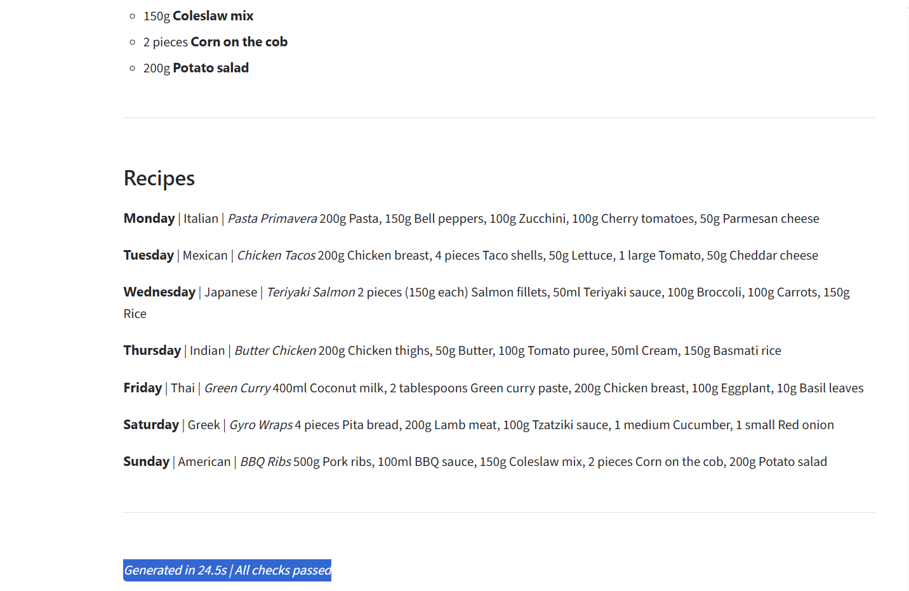
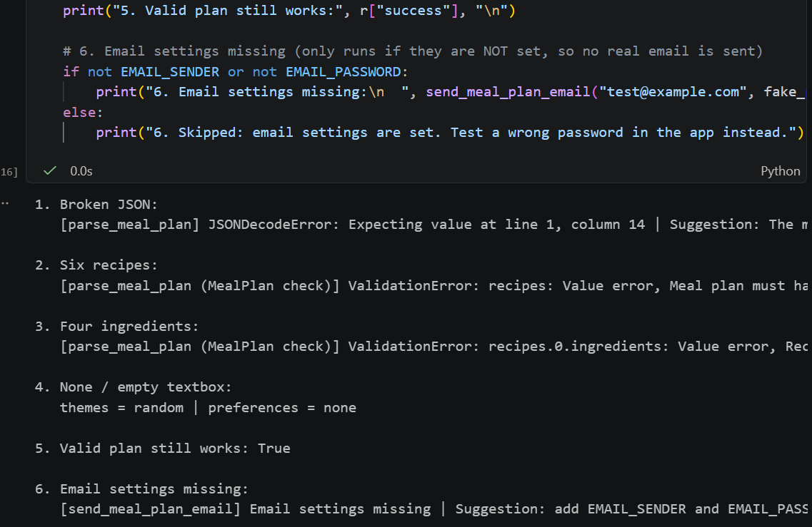
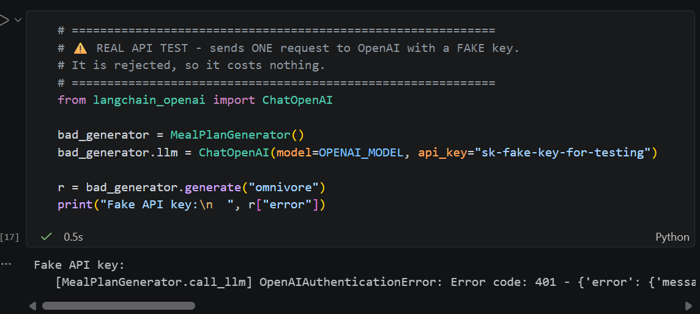
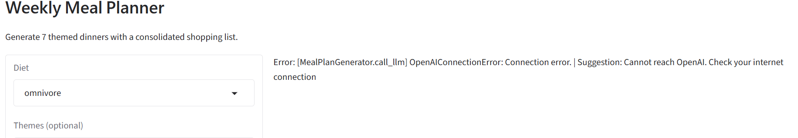
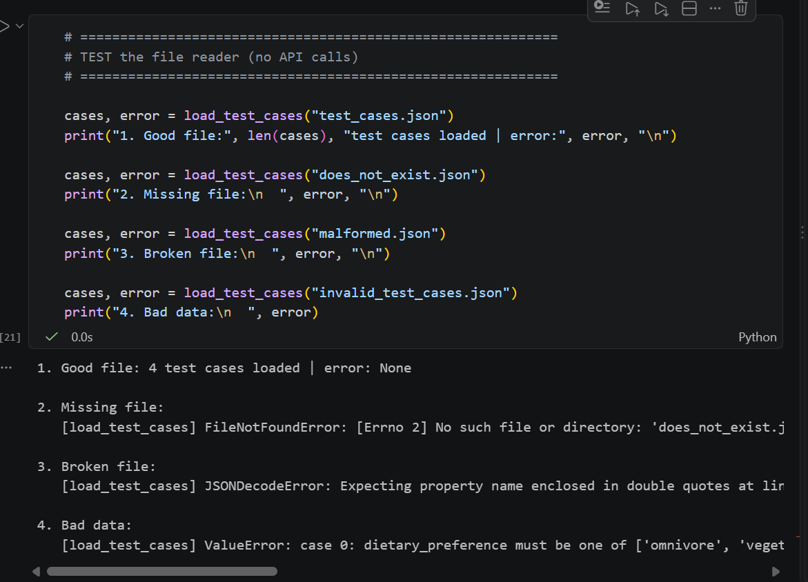
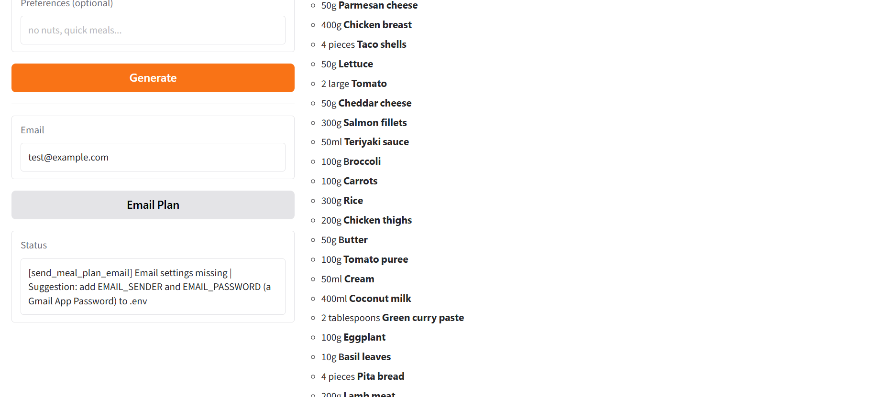

# Meal Planner Refactoring Lab: Summary

## Summary
I chose the path of refactoring the provided meal planner notebook step by step, following the teacher's hints file, while keeping an untouched copy (`meal_planner_original.ipynb`) for comparison. I removed the email secrets from the notebook so they are read from `.env` instead (I did not add real email settings, so the app shows a clear "Email settings missing" message), created helper functions for repeated code (`format_ingredients`, `with_default`, `extract_json`, `format_error`), split the monolithic `generate()` into small single-job functions, fixed the bug where the Email button generated a new plan instead of sending the one on screen, and added clear error handling around the API call, JSON parsing, validation, email and file input. My main challenge was testing errors without spending money on API calls, which I solved by replacing the model call with a fake answer in my tests, and also finding out that my API key was set outside the notebook, so I tested the missing-key check with a test setting instead. I learned that refactoring means the user sees the same result while the code becomes safer and easier to test, and that a good error message must say where, what and how to fix it.

## Before / after comparison

| Area | Before | After |
|---|---|---|
| Secrets | Email and password typed in the notebook | Removed from the notebook; read from `.env` (not filled in, so the app shows "Email settings missing"), and `.env` is in `.gitignore` |
| Missing API key | `TypeError` that does not mention the key | `[config] Missing setting: OPENAI_API_KEY` + suggestion |
| API call | Outside `try`; app crashed with a generic "Error" | Protected; separate messages for wrong key, rate limit, timeout, no internet |
| `generate()` | One function doing 5 jobs | Calls `build_inputs()`, `call_llm()`, `parse_meal_plan()`, `make_result()` in order |
| JSON cleanup | Fragile `split("```")` | `extract_json()` works with text before the JSON or a missing fence |
| Result dict | Success and failure had different keys | `make_result()` always returns the same 4 keys |
| Email button | Generated a NEW plan (~19s, extra API call) | Sends the plan on screen via `gr.State` (1–2s) |
| Email errors | "Connection unexpectedly closed" | "Email settings missing" / wrong password / no internet, each with a suggestion |
| Repeated code | Ingredient line and "if empty, use default" copy-pasted | One helper each |
| Unused code | `shopping_parser`, `SHOPPING_LIST_PROMPT`, `EXCLUDED_BASICS`, `langchain-anthropic` | Removed |
| Test cases | Hardcoded list, 4 paid API calls on every Run All | Loaded from `test_cases.json`; real API tests behind `RUN_REAL_API_TESTS = False` |
| File errors | Not tested | Missing file, broken JSON and bad data each give a clear message |
| Public link | `share=True` created a public URL | `share=False` keeps the app local |

## Results
- Baseline: 7 recipes, all checks passed in 19.03s
- After: 7 recipes, all checks passed in 24.5s (time depends on OpenAI)
- Real API tests: 4/4 PASS

## Screenshots


**After: success**


**Invalid data (6 recipes, 4 ingredients, broken JSON)**


**API error (fake key)**


**No internet**


**Missing file**


**Email status**
